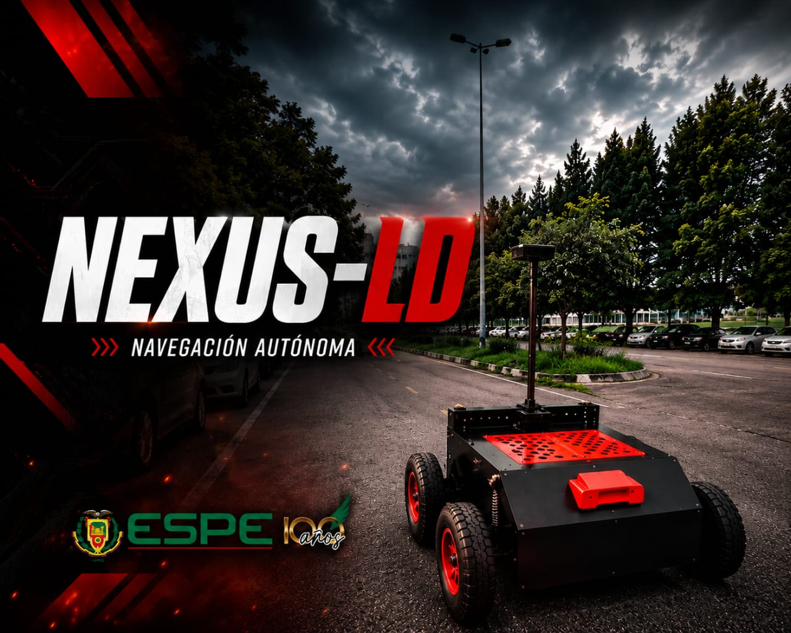
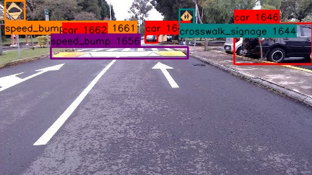
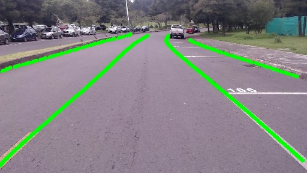

---

# Autonomous Navigation for a Differential Drive Mobile Robot (Jetson Branch)

Autonomous navigation and control system developed in **ROS 2 Humble** for a differential-drive mobile robot, adapted for deployment on an **NVIDIA Jetson** platform. The project integrates a real-time perception pipeline based on lightweight neural networks, state estimation using an **Extended Kalman Filter (EKF)**, and trajectory control using **Non-linear Model Predictive Control (NMPC)**.

> **Note:** This branch presents slight changes compared to the `main` branch. The main modifications are oriented toward the Jetson within ROS 2, and include sending the image directly instead of a compressed image.

---
## Author
* **Luis Raynel Vasquez Quishpe**  
  *Email:* luchitov2001@gmail.com

<p align="center">
  
</p>

---

## Repository Structure

### Node Distribution in ROS 2
```text
src/
├── cpp_nodes/             # Camera communication
|                          # Neural network execution,
|                          # IPM transformation
|                          # Control ESP32 communication. 
| 
├── custom_interfaces/     # Custom messages
| 
├── filter_ekf/            # Robot linear and angular velocity filtering
| 
├── navigation_system/     # NMPC control algorithm
| 
├── params/                # YAML configuration files
|                          # Neural network files
| 
├── perception_stack/      # Geometric lane estimation
|                          # EKF filtering of the lane model
|                          # Image capture
|                          # Visual debugging
| 
├── robot_description/     # URDF/Xacro models and TF configurations
│                          # RViz2 configuration
| 
├── robot_drivers/         # WebRTC and WebSocket communication
| 
├── saves/                 # Nodes for real-time system data logging
|                          # 3 nodes for data and image playback
| 
├── system_management      # Nodes for real-time system monitoring
|                          # Communication with the safety ESP32
└──                        # Full system launch file 
```

---

## Prerequisites
* OS: Ubuntu 22.04 LTS

* ROS 2: Humble 

* C++ / Python dependencies:

    * OpenCV

    * TensorRT & CUDA (for GPU-accelerated inference)

## Usage / Execution

To start all system nodes on the Jetson:
```bash
ros2 launch system_management management_all_system.launch.py 
```

---

## Neural Networks

The trained models are provided in both their original format and ONNX format.

- 📁 [Google Drive of neural networks](https://drive.google.com/drive/folders/1ZxTVijdh90kl1DD3gjYYYsyJzCp4-xVn)

Starting from the ONNX model, it is necessary to generate a TensorRT model and place the resulting file in the `params` folder.

```bash
trtexec --onnx=twinlite_512x288_lines_v2.onnx --saveEngine=twinlite_FAST_32bit_ORIN.engine --fp16 --builderOptimizationLevel=5
```

### YOLOv11n Detection Network

<p align="center">
  
</p>

### [TwinLiteNet](https://github.com/chequanghuy/TwinLiteNet.git) Lane Segmentation Network

<p align="center">
  
</p>

---
